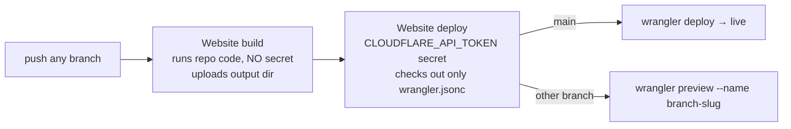

# website-kickstart — zero-click site provisioning

**Intent:** a new tenant website costs one command and no dashboard clicks; the practice then edits it
through ReplyPen chat (replypen `features/website-editing.md`). Every step reads live state first, so a
rerun after a failure continues where it stopped.

**North star: no site goes live with an unguarded contact form.** Every form is bot-checked by default
(Cloudflare Turnstile, one fleet widget, verified by ReplyPen before any mail goes out); the only human step
is adding a custom domain to the widget. Contract and limits: replypen `.agents/skills/features/website-forms.md`. Operator laptop only (Cloudflare + GitHub admin creds).

```bash
KS=~/code/replypen/replypen-brain-skills/skills/website-kickstart/scripts/kickstart_site.py
mise -C ~/code/replypen/replypen exec -- uv run -q $KS <github-org> <slug> \
  --project <rp project> (--tenant <rp tenant> | --project-scope) --name "<Naam zoals op de site>" [--dry-run]
```

Scope is explicit: `--tenant` = a tenant's site (mirror on the tenant, form → `/forms/<project>/<tenant>`);
`--project-scope` = the **project's own site** (e.g. `momentum-tools`, no tenants): project mirror (`rp --scope
project`, so an inherited tenant can't capture it), form → `/forms/<project>`, landing in the project's
tenant-less mailbox. Never invent a tenant just to host a site.

Repo + Worker = `site-<slug>`; live `https://site-<slug>.rootcause-sites.workers.dev`, previews
`https://<branch>-site-<slug>.rootcause-sites.workers.dev`. Output: `✓/✗ step — detail` per step, then a
summary (repo, URLs, deploy run, screenshots in `--out`, default `~/Downloads`) and a chat sentence to try. ~3 min.

## Deploy pipeline

Every site deploys with the template's `.github/workflows/deploy.yml`, on every push:



> [!IMPORTANT]
> Chat- and agent-made branches change repo code, so the job that runs that code holds no credential:
> a branch can only shape its own preview. The deploy job runs no repo file, writes
> `/replypen-revision.json` = `{"revision": "<sha>"}`, and is the check-run ReplyPen waits for.

`CLOUDFLARE_API_TOKEN` (repo secret) = `CF_SITES_DEPLOY_TOKEN`, an account-owned token limited to Workers
Scripts Write + Account Settings Read; `CLOUDFLARE_ACCOUNT_ID` is a repo variable.

| Step | What | Notes |
|---|---|---|
| preflight | a same-named Worker in the shared account must already be ours | read-only; refuses before any write (the first deploy would overwrite it) |
| repo | `POST /repos/replypen/site-template/generate`, fill `__WORKER_NAME__`/`__SITE_NAME__`/`__PROJECT__`/`__TENANT__` (no tenant ⇒ `__PROJECT__/__TENANT__` → `<project>`), push main | `--adopt`: existing repo, checks `wrangler.jsonc` name = Worker. Any framework works (the build job runs `build.sh`, the deploy reads `assets.directory`). The repo must carry `.github/workflows/deploy.yml` |
| github app | add the repo to the `replypen` App on the org | id via `GET /orgs/<org>/installations` (gh login); `PUT /user/installations/{id}/repositories/{repo}` with the PAT. Refuses while it lacks Checks/Statuses read (prints the accept URL; else chat edits fail "could not authenticate with GitHub"). Where no token may list/edit app repos (org forbids classic PATs) it prints "unverifiable, add by hand" + the settings URL and continues; the mirror refresh proves it |
| deploy | `gh secret set` (token on stdin) + `gh variable set`, then wait for check-run `Website deploy` success on the head sha; dispatch `gh workflow run deploy.yml --ref main` when there is none, it failed (the push run raced the secret) or the live site is stale. Live 200 + name, `/replypen-revision.json` = sha | the first deploy creates the Worker. Secret re-set every run (unreadable; converges a rotated token) |
| ReplyPen mirror | `rp project repo add name=site role=website live_url preview_url_template deploy_check="Website deploy" revision_path=/replypen-revision.json form_challenge=turnstile` + `dev mirror refresh --expect-sha` | `--mirror-name` if the tenant has another `site`. `form_challenge` only when `_data/site.yml` has a `turnstile_sitekey`, so the server never demands a token the page can't produce |
| screenshots | Browser Rendering, 390 px + 1280 px full page | 429 = free-tier rate limit, retried |

**Ownership (never touch someone else's site).** A Worker counts as ours when its
`https://<worker>.rootcause-sites.workers.dev/replypen-revision.json` names a commit GitHub finds in
`<org>/site-<slug>` (template-generated repos start their own history, so another site never matches; works
from any machine). Anything else needs `--adopt` (provision) or `--force-orphan` (teardown); a marker from
another repo is always refused. An existing repo this machine did not personalise
(`~/.local/state/website-kickstart/<account>-<worker>.json`) needs `--adopt`. Subprocesses get a minimal env
and stdin `/dev/null` (the deploy token reaches `gh` on stdin only); known secret values are redacted from
all output. `--name` is written as a JSON-encoded YAML scalar and parsed back before the push.

**Env** (`~/.config/mise-env/replypen/replypen.env`, hence `mise -C …/replypen exec`):
`CF_SITES_USER_TOKEN` (operator reads + teardown: list/delete Workers), `CF_SITES_DEPLOY_TOKEN` (goes only into
the repo secret), `GH_SITE_PROVISIONING_PAT` (classic, `repo` + `read:org`; an org that forbids classic PATs,
e.g. `pro-backup`, gets the `gh` login token instead), `CF_BROWSER_RENDERING_TOKEN`; plus a `gh` login that
owns the org (sets secrets/variables, dispatches) and an `rp` login. Account default: Rootcause Sites
`60c5feed78b351b48868d3a691184c4b`.

**Verify:** the summary's `deploy run` link is green; `curl https://<live>/replypen-revision.json` names
the head sha of main; a chat edit opens a branch whose `Website deploy` check posts a preview URL. Rerunning
the same command must report every step as already done. Tests (fake GitHub/Actions/Cloudflare/rp world):
`uv run --no-project --with pyyaml python -m unittest skills/website-kickstart/tests/test_kickstart.py`.

**Replacing a WordPress site?** Before the domain switch run `rp … project knowledge sync get`: a `supporthero`
(WordPress REST) `base_url` on that domain breaks the daily KB sync. Publish a WP-shaped feed from the new site
(reference: `momentumtools/site-momentumtools` `wp-json/*.liquid`, page ≥ 2 → 400 like WP). Zone in another
Cloudflare account than Rootcause Sites? A route proxy Worker on that zone (same repo, `ops/b4b-proxy/`) avoids DNS changes.

**After:** fill the `[placeholders]` via chat (never invent facts); keep the site's `AGENTS.md` current
(the chat agent gets it pasted; what belongs there: [docs/website-context.md](../../docs/website-context.md)); coding agents on a
laptop use the template's vendored `website-dev` skill (refresh: `pnpm dlx skills add replypen/replypen-skills -s website-dev -y`); domain/DNS move → the project's site
runbook (DentAI: `dentai/.agents/skills/practice-websites/SKILL.md`), then
`rp … project repo set site live_url=https://www.<domain>` and `url:` in `_data/site.yml`; later reruns
need `--live-url https://www.<domain>`, else they reset the mirror to workers.dev.
**Before the DNS switch:** `scripts/turnstile_domain.sh <apex>` (wrangler login of info@b4bit.be). Skip it and the
widget won't render on the new domain: the form can't be sent at all. `*.rootcause-sites.workers.dev` is covered already.
Adopting an older site without the widget: sitekey + markup deployed first, then `form_challenge=turnstile`, never reversed.
Both apex and `www` as Worker custom domains serve 200: add one zone **Single Redirect** for the non-canonical host
(`PUT /zones/<id>/rulesets/phases/http_request_dynamic_redirect/entrypoint`, `concat("https://www.<domain>", http.request.uri.path)`,
301, `preserve_query_string`). `CF_SITES_USER_TOKEN` has Dynamic URL Redirects Write (since 2026-10-25); no other operator token does.

**Throwaway:** `--teardown site-<slug>` removes the rp mirror, the Worker, App access and the repo's deploy
secret, then renames the repo to `site-<slug>-teardown-<ts>` and archives it (our tokens lack `delete_repo`;
it prints the delete command). Ownership is proven first (wrong org = refusal, nothing changed); a missing
repo is an error. Rerun resumes a partial teardown: the renamed repo is found via the record or GitHub's
redirect, deletes retry and treat 404 as done.
